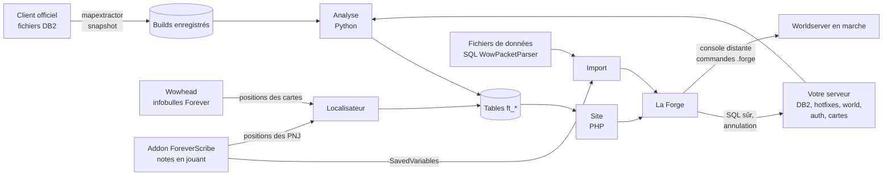

# ForeverTracker

Développé par **[FilinoDZ](https://github.com/filinodz)**.

**Voyez ce qui manque à votre serveur WoW Forever, et corrigez-le.**

ForeverTracker compare le client officiel de World of Warcraft Forever avec votre serveur basé sur TrinityCore. Il
liste chaque ressource livrée par Blizzard (donjons, boss, zones, quêtes, objets, sorts, talents, recettes, montures,
mascottes, jouets, hauts faits, points de vol), vérifie si les joueurs peuvent vraiment l’obtenir ou la faire sur
votre serveur, explique pourquoi quand ce n’est pas le cas, et corrige : données du core manquantes, entraîneurs,
marchands, instances, PNJ jamais placés, et le butin, les marchands et les quêtes des fichiers de données du monde
que vous importez.

[English](README.md) · [Installation](docs/INSTALL.md) · [La Forge](docs/FORGE.md) · [Placements et imports](docs/SPAWNS.md) · [Configuration](docs/CONFIGURATION.md) · [Architecture](docs/ARCHITECTURE.md) · [Changelog](CHANGELOG.md)

## Installation en trois étapes (Windows)

1. **Téléchargez** `ForeverTracker-<version>.zip` depuis la [dernière version](https://github.com/filinodz/ForeverTracker/releases/latest)
   et décompressez-le où vous voulez (par exemple à côté de votre serveur).
2. **Double-cliquez sur `ForeverTracker.exe`.** Le lanceur trouve PHP et Python, démarre le site et ouvre l’assistant
   d’installation dans votre navigateur.
3. **Suivez l’assistant.** Il trouve tout seul votre serveur et votre client de jeu, teste les bases de données,
   demande un mot de passe administrateur, puis lance la première analyse (quelques minutes). C’est fini : le
   tracker s’ouvre.

|  |  |
|---|---|

**Ce qu’il vous faut**

| | |
|---|---|
| Votre serveur | Un serveur WoW Forever basé sur TrinityCore (un repack convient) : ses bases MySQL `auth`, `world`, `hotfixes`, et son dossier de données (`dbc`, `maps`, `vmaps`) |
| Le jeu | Le client officiel WoW Forever installé sur le même ordinateur (pour lire les données officielles) |
| PHP 8 avec `mysqli` | Beaucoup de repacks en fournissent déjà un : le lanceur le trouve. Sinon [windows.php.net](https://windows.php.net/download/) (zip, VS16 x64 Thread Safe) décompressé dans `C:\php` |
| Python 3.9+ | [python.org](https://www.python.org/downloads/) — cochez *Add python.exe to PATH* |

Windows peut afficher « Windows a protégé votre ordinateur » au premier lancement, car le lanceur n’est pas signé :
*Informations complémentaires* › *Exécuter quand même*. Son code source est dans [`tools/launcher`](tools/launcher).
Linux, Apache / nginx ou installation à la main : voir [le guide d’installation](docs/INSTALL.md).

## Fonctionnalités

### Couverture du contenu officiel

Treize types de ressources, chacune avec un statut (*disponible*, *incomplète*, *manquante*), un score et la liste des
vérifications réussies ou échouées, en français et en anglais, avec une liste du travail par priorité, un export CSV
et une recherche globale (`Ctrl K`).

| Ressource | Vérifications |
|---|---|
| Objet | connu du core ; obtenable par le butin d’un PNJ ou objet placé, un marchand placé, une quête faisable, un artisanat apprenable, un conteneur ou la boutique |
| Quête | ligne `quest_template` ; donneur et valideur placés ; objectifs réalisables ; non désactivée |
| Donjon / raid | terrain extrait ; `instance_template` ; téléporteur d’entrée ; PNJ placés ; chaque boss placé ; maillage de navigation |
| Boss | un PNJ de ce nom placé dans l’instance ; scripté (ScriptName ou SmartAI) |
| Zone | PNJ placés dans son emprise ; la plupart de ses quêtes faisables ; cimetière |
| Sort, talent, recette | connu du core ; apprenable (entraîneur, récompense de quête, automatique, objet) ; conseil de script pour les effets « dummy » |
| Monture, mascotte, jouet | l’objet ou le sort qui l’apprend est obtenable |
| Haut fait | connu du core ; `achievement_reward` quand il a une récompense |
| Point de vol | un maître de vol placé près du point |

|  |  |
|---|---|

### Changelog de chaque build du client

Chaque build enregistré du client est comparé au précédent, champ par champ : ce que Blizzard a ajouté, modifié ou
retiré. Les administrateurs peuvent y joindre les notes de mise à jour de Blizzard.

### Infobulles comme en jeu

Survolez n’importe quelle ressource pour voir son infobulle, calculée avec les formules du core : niveau d’objet,
armure, dégâts et DPS, caractéristiques, effets « Utiliser / Équipé / Chances quand vous touchez », ensembles, prix de
vente ; coût, portée, incantation, recharge, composants et description des sorts avec leurs valeurs.

|  |  |
|---|---|

### La Forge

L’espace d’administration. Chaque changement est prévisualisé en SQL, appliqué dans une transaction par base,
enregistré dans l’historique avec son annulation, et peut être refait sans risque : une ligne déjà présente sur le
serveur n’est jamais insérée deux fois.

| Partie | Ce qu’elle fait |
|---|---|
| **Objets** | Chaque objet que les joueurs ne peuvent pas obtenir, avec la raison et les sources trouvées dans les fichiers importés ; applique ces sources, ou fait vendre l’objet par le marchand de votre choix |
| **Données du core** | Copie dans la base `hotfixes` les enregistrements officiels que le core ne connaît pas (objets, sorts, montures, mascottes, jouets, hauts faits, talents et tout ce dont ils dépendent) |
| **Entraîneurs** | Enseigne les sorts de classe et de métier que personne n’enseigne, chez les entraîneurs placés de la même spécialité, avec un niveau et un prix pris sur leurs voisins |
| **Instances** | Crée la ligne `instance_template` des donjons et raids |
| **Placements** | Place les PNJ et objets dont le contenu a besoin mais que personne n’a placés, à leur position officielle |
| **Imports** | Fusionne ce que l’addon **ForeverScribe** a noté pendant que vous jouiez (marchands, butin, donneurs de quête, positions des PNJ), et les fichiers de données du monde au format SQL de WowPacketParser |

|  |  |
|---|---|

### Placements : les PNJ que personne n’a placés

Beaucoup de quêtes ne marchent pas seulement parce qu’un PNJ n’a jamais été placé : le modèle existe, la quête y
renvoie, mais personne ne se tient dans le monde. Le **localisateur** trouve les donneurs et valideurs de quête,
objectifs, marchands, entraîneurs, butins rares et boss que votre serveur connaît sans les avoir placés, et où ils se
trouvent d’après les cartes publiques de Wowhead. La Forge les place sur le serveur en marche (hauteur exacte calculée par le serveur), dans la
base, en jeu avec l’addon **ForeverForge**, ou donne les commandes MJ.

|  |  |
|---|---|

### ForeverScribe et imports : le butin, les marchands et les quêtes

Le butin, les listes des marchands et les donneurs de quête sont des données du serveur : elles ne sont jamais dans
le client. Installez l’addon **ForeverScribe** dans votre jeu et jouez sur les royaumes officiels (il se met en pause tout seul sur
les serveurs privés) : il note, par l’API normale des addons, ce que
vendent les marchands, ce que lâchent les PNJ et les coffres, qui donne et valide les quêtes et où se tiennent les
PNJ. Tant que le lanceur tourne, ForeverTracker importe les nouvelles notes à chaque déconnexion ou `/reload` ; la
Forge prévisualise et applique ce qui manque à votre serveur, avec annulation. ForeverTracker importe aussi des
fichiers de données du monde au format SQL de [WowPacketParser](https://github.com/TrinityCore/WowPacketParser).

Thème clair, interface française et téléphone :

| | | |
|---|---|---|
|  |  |  |

## Comment ça marche

**1. Le contenu officiel.** Les fichiers DB2 du client de chaque build (extraits avec le `mapextractor` de votre core)
sont enregistrés dans `data/builds/<build>/`. Un lecteur WDC5 les décode avec les structures de votre core
(`DB2LoadInfo`), colonnes compressées, creuses et relationnelles comprises. Comparer un build au précédent donne le
changelog.

**2. L’analyse.** Elle lit ces tables à côté de votre serveur : ses propres DB2, les bases `hotfixes`, `world` et
`auth`, et ses maps, vmaps et mmaps. Pour chaque ressource elle fait les vérifications ci-dessus (pour un objet : un
PNJ ou objet placé le laisse-t-il tomber, références de butin comprises, un marchand placé le vend-il, une quête
faisable le donne-t-elle, une recette apprenable le fabrique-t-elle…) en recommençant tant que de nouvelles choses
deviennent obtenables, car les chaînes de quêtes débloquent des objets qui débloquent d’autres quêtes. Les résultats
vont dans les tables `ft_*` de ForeverTracker ; les bases du jeu ne sont que lues.

**3. La Forge.** Une correction n’est pas stockée en SQL mais en opérations : une table, ses colonnes, les lignes à
ajouter et les colonnes qui identifient une ligne. Appliquer une sélection fusionne les opérations, garde chaque ligne
une seule fois, demande au serveur lesquelles existent déjà à cet instant et les écarte, écrit le reste dans une
transaction par base, et enregistre une annulation qui supprime exactement ce qui a été inséré.
`tools/forge-check.php` teste toutes les corrections à blanc.

**4. Les positions (localisateur).** Pour chaque PNJ ou objet non placé dont le contenu a besoin, le localisateur demande au
service public d’infobulles Forever de Wowhead (poliment, une requête à la fois, avec cache) où il se trouve : une
zone et des points en pourcentage de la carte de cette zone. Les tables de cartes du client (`UiMap`,
`UiMapAssignment`, `UiMapGroupMember`) donnent le rectangle du monde dessiné sur chaque carte, ce qui reconvertit les
pourcentages en coordonnées du monde, à quelques mètres des positions officielles en extérieur. Les points sont
regroupés en placements (des groupes pour les objectifs de quête, un PNJ par endroit sinon), et le placement existant
le plus proche donne une indication de hauteur et une orientation. Dans les donjons, Wowhead n’a pas de position :
l’addon ForeverForge permet à un MJ de les placer à la main.

**5. Le placement.** Le module optionnel du core ([`core/forge_commands.cpp`](core/README.md)) ajoute `.forge spawn` au
worldserver : le serveur calcule la hauteur du sol à partir de ses maps et vmaps (bâtiments compris), enregistre le
placement comme `.npc add` et l’affiche aussitôt. Le site envoie ces commandes par la console distante (RA) ; l’addon
**ForeverForge** les envoie en jeu par le canal de commandes d’addon de TrinityCore, ou se rend à chaque point avec
`.go xyz` sur un core sans le module.

**6. ForeverScribe et les imports.** Le butin, les listes des marchands et les donneurs de quête n’arrivent jamais dans
les fichiers de données du jeu, mais le jeu les montre quand on joue. ForeverScribe écoute les événements que tout
addon peut utiliser (fenêtre de marchand, fenêtre de butin et ses sources, dialogue de quête) et garde ce qu’il a vu
dans son fichier SavedVariables : la liste du marchand avec les stocks limités et les coûts, combien de corps ou de
coffres ont été fouillés et combien de fois chaque objet est tombé (ce rapport devient la chance de butin), qui a
proposé et qui a validé chaque quête, et où se tenait le joueur en parlant à un PNJ (coordonnées du monde de
`UnitPosition`, ou carte de la zone convertie comme celles de Wowhead). ForeverTracker transforme ce fichier en tables
comme un fichier SQL importé — `npc_vendor` (le drapeau marchand est ajouté s’il manque), `creature_loot_template`,
`gameobject_loot_template`, donneurs et valideurs de quête — et le localisateur préfère ces positions à celles de
Wowhead. Les données du monde de TrinityCore circulent aussi en SQL au format de WowPacketParser ; ForeverTracker lit
ces fichiers également. Chaque import est fusionné de la même façon : seules les lignes `INSERT` sont lues (les `DELETE` et `UPDATE` du
fichier ne sont jamais exécutés), les lignes déjà présentes sont écartées, les placements reçoivent de nouveaux guid
et ne sont jamais doublés (un placement existant à moins de 3 mètres l’emporte), un PNJ reçoit le lien vers sa table
de butin quand il n’en avait pas, et les colonnes ou tables que votre core n’a pas sont ignorées.

## Documentation

| | |
|---|---|
| [Installation](docs/INSTALL.md) | Lanceur et assistant, installation à la main, Linux, Apache et nginx, mises à jour |
| [La Forge](docs/FORGE.md) | Chaque correction, comment elle est appliquée et annulée |
| [Placements et imports](docs/SPAWNS.md) | Le localisateur, les quatre façons de placer, le module du core, les addons ForeverForge et ForeverScribe, l’import des fichiers SQL WowPacketParser |
| [Configuration](docs/CONFIGURATION.md) | Chaque réglage de `config.ini` |
| [Architecture](docs/ARCHITECTURE.md) | Le code : analyse, tables, site, moteur de la Forge |

## Sécurité

- L’analyse ne fait que lire les bases du jeu.
- La Forge n’écrit qu’après confirmation d’un administrateur, dans une transaction par base, et garde le SQL exact et
  son annulation dans l’historique. Sauvegardez quand même vos bases.
- L’assistant d’installation ne répond qu’à l’ordinateur qui fait tourner ForeverTracker tant qu’il n’est pas
  configuré, puis seulement aux administrateurs.

## Licence

MIT — voir [LICENSE](LICENSE). Outil non officiel, sans lien avec Blizzard Entertainment. Contenu et icônes de World of
Warcraft © Blizzard Entertainment ; les icônes sont chargées depuis le CDN d’images public de Wowhead.
