# Forever Tracker

Developed by **[FilinoDZ](https://github.com/filinodz)**.

**See what your WoW Forever server is missing — and fix it.**

Forever Tracker reads the official game client build after build, lists every resource Blizzard ships, and checks
each one against your TrinityCore-based server: core data, spawns, loot, vendors, trainers, quest givers and
scripts. Every gap comes with the reason and the fix, and the **Forge** applies the fixes for you — up to spawning
the missing creatures at their official positions.

[Français](README.fr.md) · [Installation](docs/INSTALL.md) · [Configuration](docs/CONFIGURATION.md) · [The Forge](docs/FORGE.md) · [Locator and spawns](docs/SPAWNS.md) · [How it works](docs/ARCHITECTURE.md) · [Changelog](CHANGELOG.md)

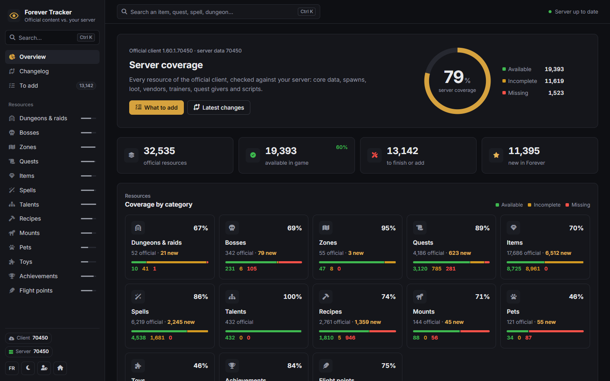

## Install in two minutes (Windows)

1. [Download ForeverTracker](https://github.com/filinodz/ForeverTracker/archive/refs/heads/main.zip) (or `git clone`) and unzip it.
2. Double-click **`ForeverTracker.exe`**. It finds PHP and Python, starts the website and opens the setup wizard.
3. The wizard finds your server and your game client by itself: confirm, choose an administrator password, and it
   runs the first analysis.

| 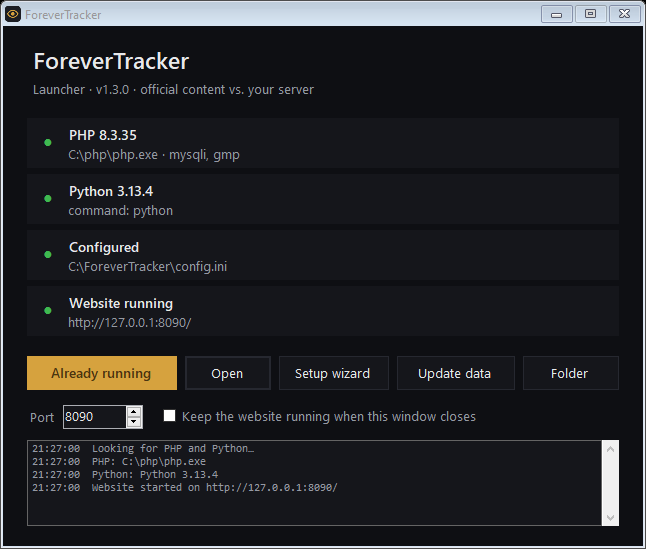 | 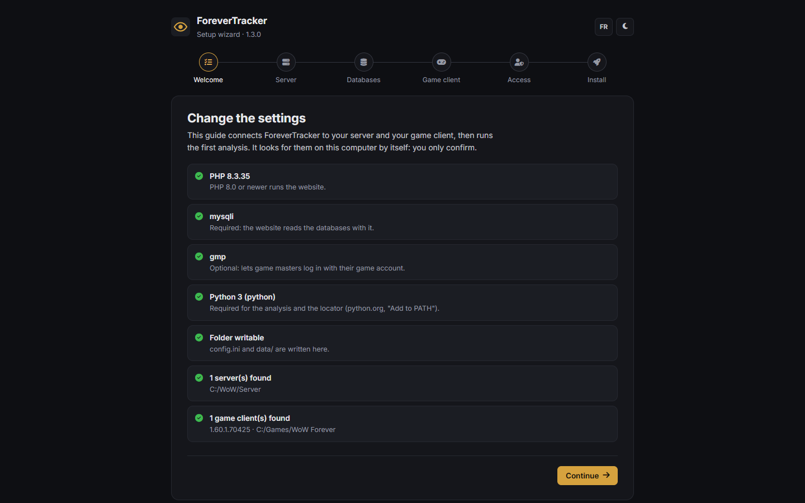 |
|---|---|

Windows may show *"Windows protected your PC"* the first time, because the launcher is not signed: *More info* ›
*Run anyway*. Its source is in [`tools/launcher`](tools/launcher) and `build-exe.ps1` rebuilds it with the C#
compiler Windows ships. Linux, or by hand: see [the installation guide](docs/INSTALL.md).

## New in 1.1

### Launcher and setup wizard

`ForeverTracker.exe` finds a PHP 8 with `mysqli` (even a portable one shipped with a repack, whose extensions it
enables) and Python, then runs the website. The wizard reads your `worldserver.conf` — databases, data folder,
remote console — tests the databases, finds the game client from its `.build.info`, extracts its data with your
core's `mapextractor` (or uses the server's DB2 files), writes `config.ini` and runs the analysis and the locator
with live progress.

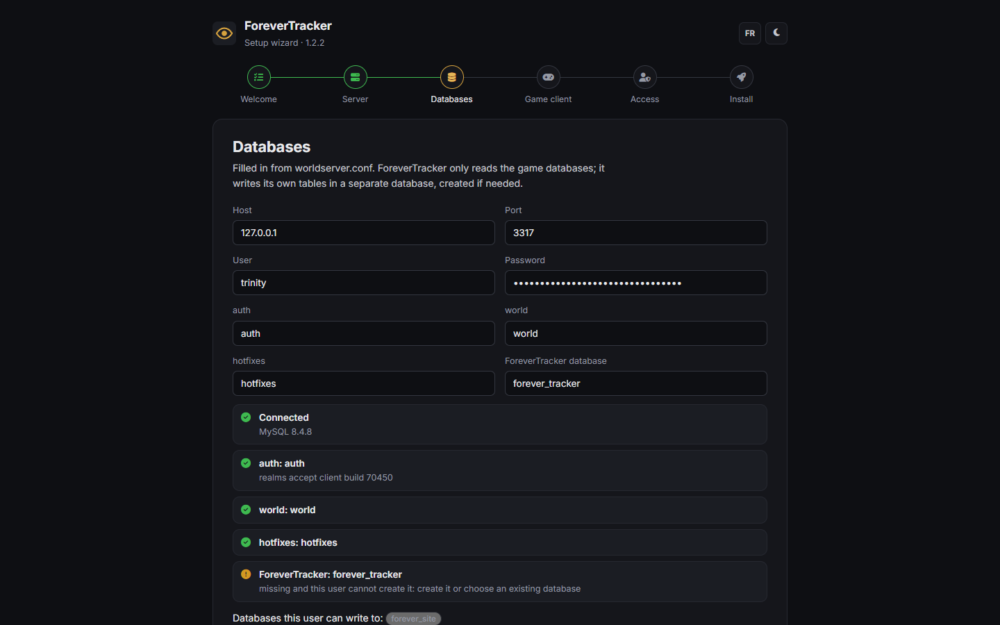

### Locator and spawns

Many quests fail only because a creature was never spawned: the template exists, the quest points to it, but nobody
stands in the world. The **locator** finds the quest givers, enders, objectives, vendors, trainers, rare drops and
bosses your server knows but never spawned, and asks Wowhead's Forever data where they stand; the client's own map
tables turn those positions into world coordinates (a few yards outdoors). The Forge then spawns them:

- **on the running server**, through the remote console and the `.forge` commands of the
  [core module](core/README.md): the server computes the ground height itself, buildings included, and every spawn
  can be rolled back;
- **in game**, with the **ForeverForge** addon (`/forge`): it spawns the whole queue for you, and *Spawn here*
  places bosses in dungeons;
- **in the database**, or as a list of **GM commands**.

|  | 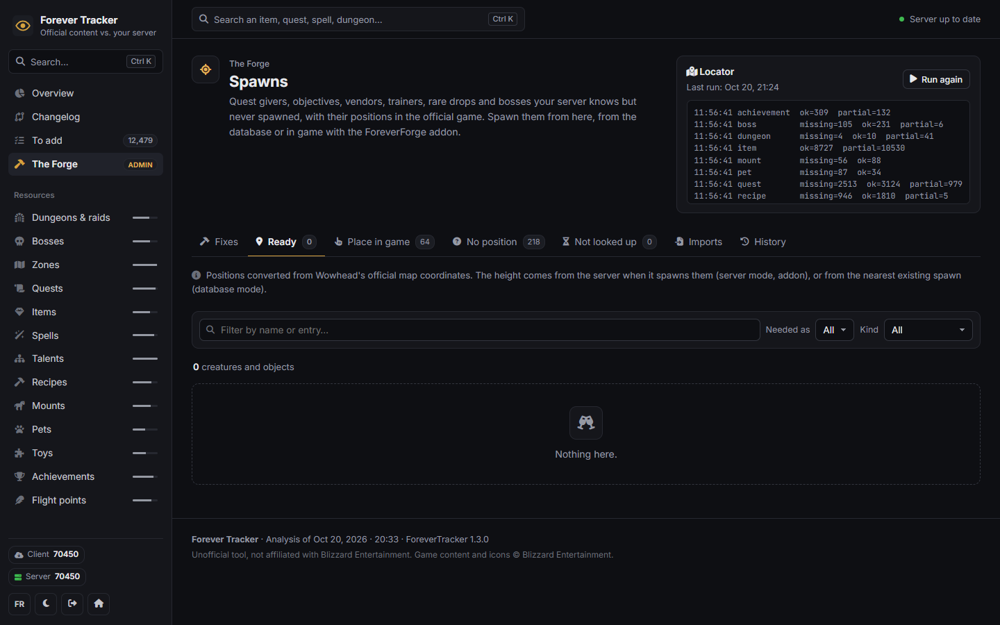 |
|---|---|

### A Forge that never fails on "duplicate entry"

Fixes are stored as operations, not raw SQL. Applying a selection merges it, inserts every row once, leaves out the
rows that already exist on the server, and keeps a rollback that removes exactly what was added. Applying twice,
overlapping fixes, rows added by hand: all safe. The preview tells new rows from existing and shared ones.

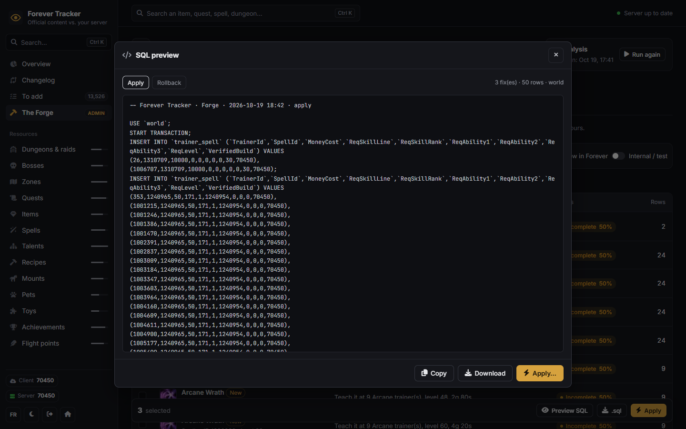

## How the tracker works

1. **Store a client build.** The official client's DB2 files (extracted with your core's `mapextractor`) are kept
   in `data/builds/<build>/<locale>/`.
2. **Compare the client with your server.** `analyse` reads those snapshots alongside your server's DB2 files,
   `world`, `hotfixes` and `auth` databases, and map data. Each resource is available, incomplete or missing, with
   a score and detailed reasons.
3. **Browse the results** on the website: coverage, resource details, tooltips, a work list and the changes between
   client builds.
4. **Fix.** The Forge previews, applies and rolls back fixes; the locator and the Spawns page place what is missing
   in the world. Run the analysis again to refresh.

The tracker needs access to your server's data; it does not analyse a remote server from its address alone.

## Features

**Coverage of 13 resource types** — dungeons and raids, bosses, zones, quests, items, spells, talents, recipes,
mounts, pets, toys, achievements and flight points. Each resource gets a status (*available*, *incomplete*,
*missing*), a score, and the list of checks it passes or fails.

**Official changelog** — every build of the client is compared with the previous one, field by field (added,
changed, removed). Administrators can attach Blizzard's own patch notes to a build.

**In-game tooltips** — hover any resource for its tooltip, computed with the core's own formulas: item level,
binding, armor, weapon damage and DPS, stats, *Use / Equip / Chance on hit* effects, item sets and their
bonuses, sell price; spell cost, range, cast time, cooldown, reagents and description, with `$s1`, `$d`, `$o1`…
filled in. Available in English and French.

**The Forge** — core data, trainers, vendors, instances and spawns, in bulk, with an SQL preview, one transaction
per operation, a history and a rollback.

| | |
|---|---|
| 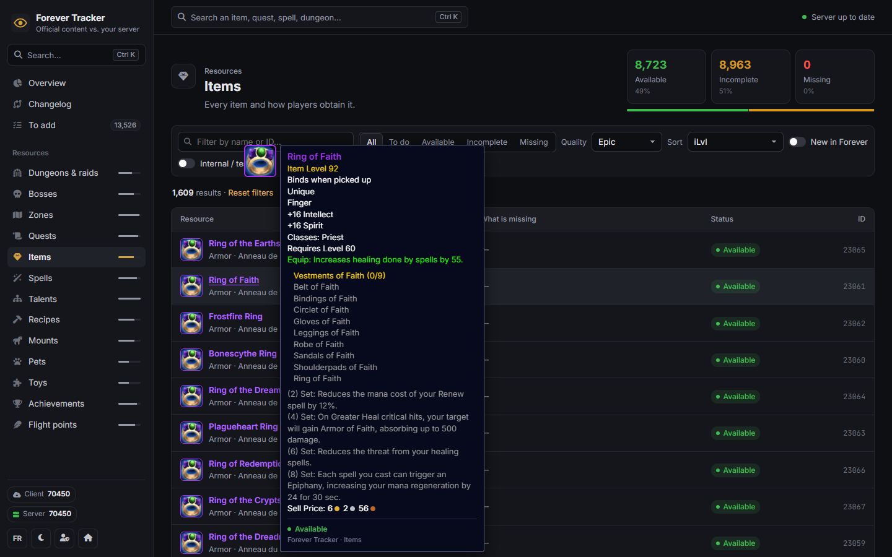 | 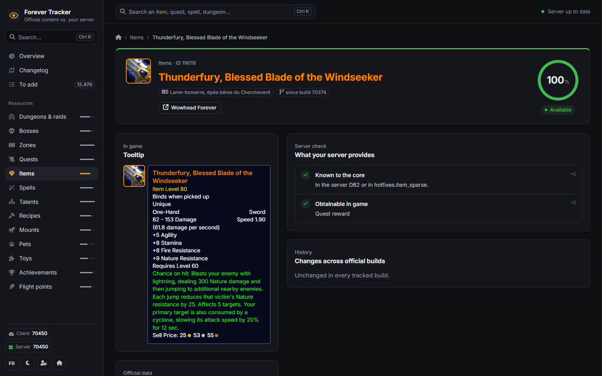 |
| 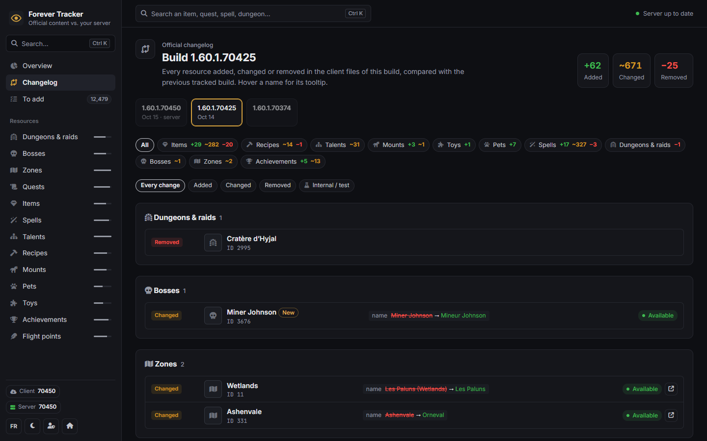 | 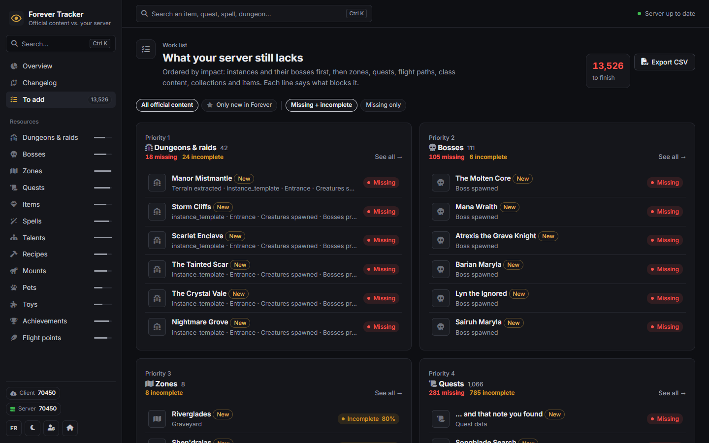 |
| 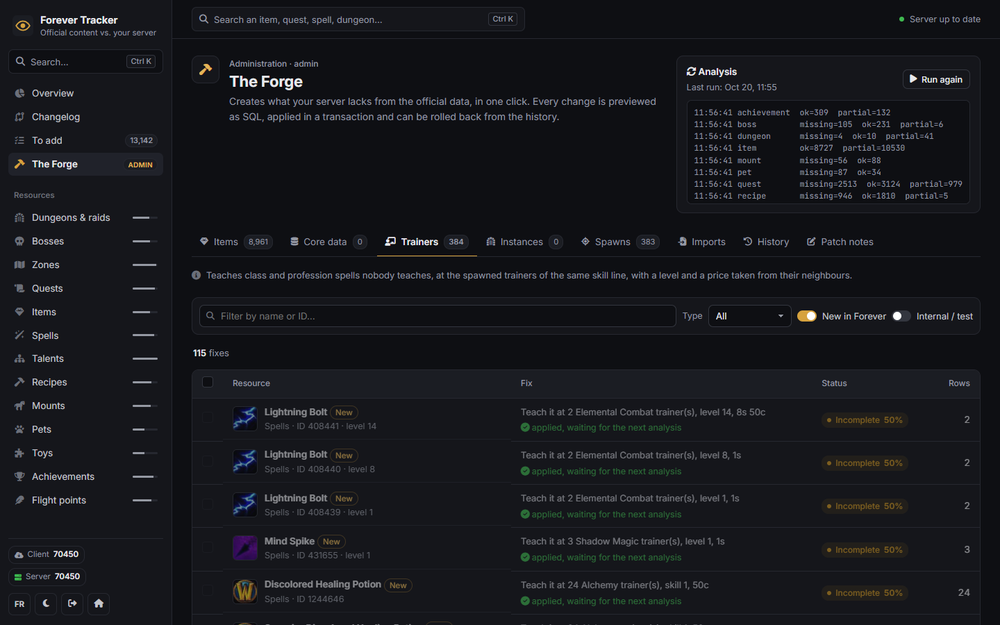 | 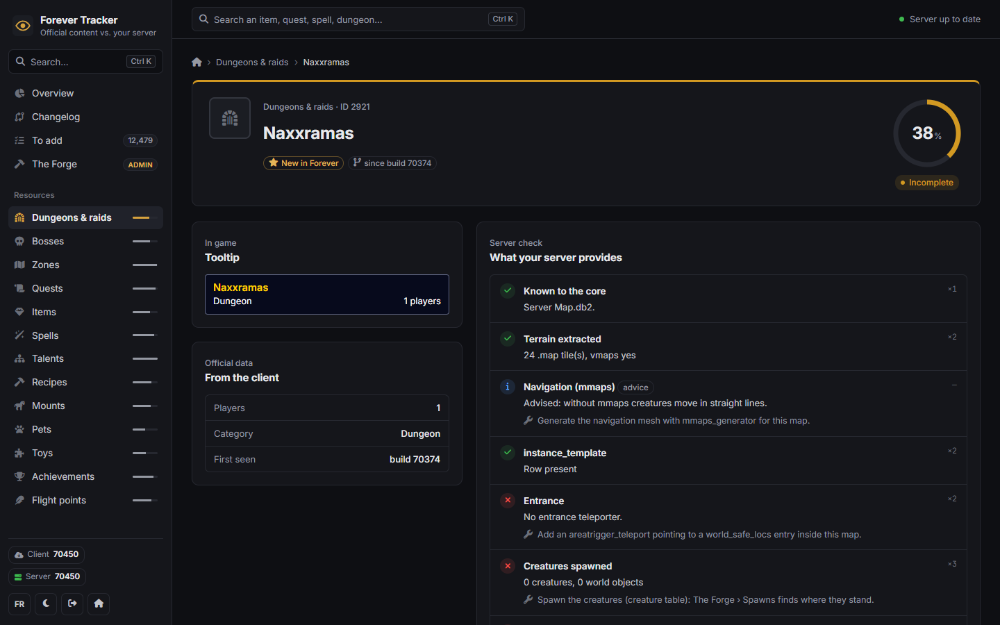 |
| 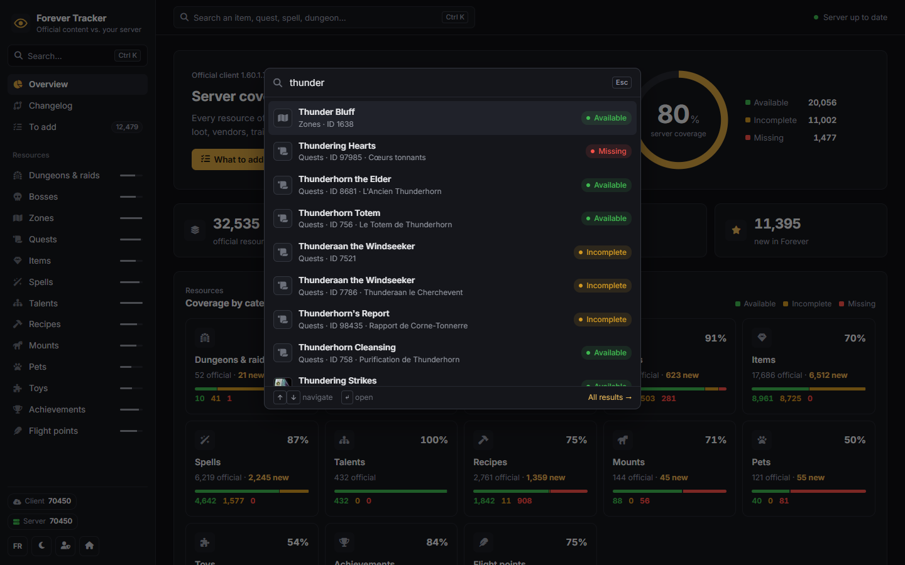 | 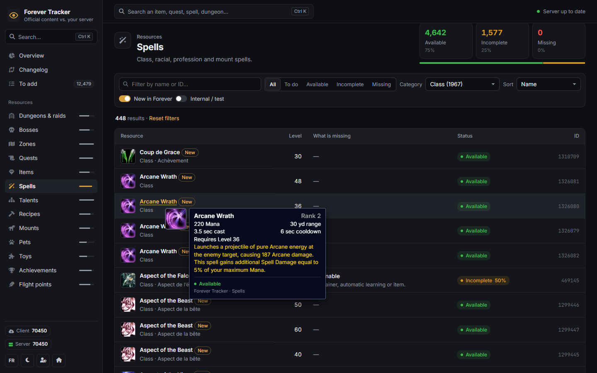 |

Light theme, French interface and phone layout:

| | | |
|---|---|---|
| 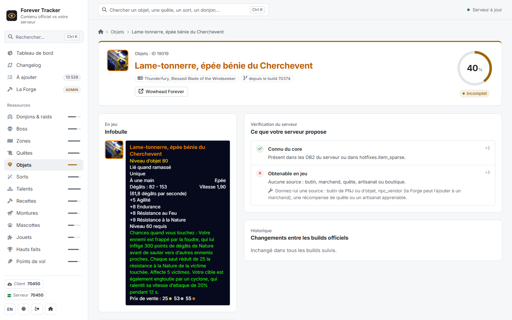 | 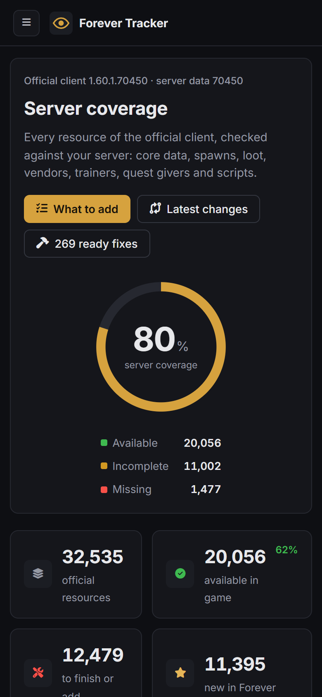 | 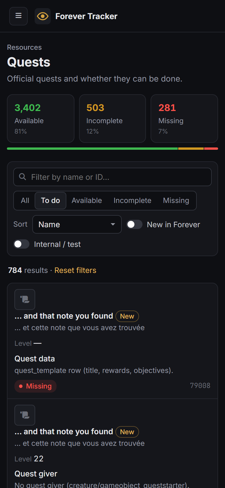 |

## What is checked

| Resource | Checks |
|---|---|
| Item | known to the core; obtainable from loot of a spawned creature or object, a spawned vendor, a doable quest, a learnable craft, a container or the shop |
| Quest | `quest_template` row; spawned giver and ender; objectives achievable; not disabled |
| Dungeon / raid | terrain extracted; `instance_template`; entrance teleporter; creatures spawned; every boss spawned; navigation mesh (advice) |
| Boss | a creature of that name spawned in the instance; scripted (ScriptName or SmartAI) |
| Zone | creatures spawned in its area; most of its quests doable; graveyard |
| Spell, talent, recipe | known to the core; learnable (trainer, quest reward, automatic, item); script advice for dummy effects |
| Mount, pet, toy | the item or spell that teaches it can be obtained |
| Achievement | known to the core; `achievement_reward` when it has a reward |
| Flight point | a flight master spawned next to the node |

## The Forge

| Fix | What it writes |
|---|---|
| Core data | Copies the official records the core does not know (items, spells, mounts, pets, toys, achievements, talents, and every record they depend on) into the `hotfixes` database |
| Trainers | Teaches class and profession spells nobody teaches, at the spawned trainers of the same skill line, with a level and a price taken from their neighbours |
| Vendors | Sells items that have no source at the vendor you choose |
| Instances | Creates the `instance_template` row of dungeons and raids |
| Spawns | Spawns the creatures and world objects the content needs at their official positions ([locator](docs/SPAWNS.md)) |

Every fix can be previewed and downloaded as SQL before it is applied. `tools/forge-check.php` dry-runs all of them
with the website's own engine, inside transactions that are always rolled back. See [docs/FORGE.md](docs/FORGE.md).

## By hand (any system)

Requirements: PHP 8.0+ with `mysqli` (and `gmp` for game-account login), Python 3.9+ (standard library only), the
`mysql` command-line client, your server's `world`, `hotfixes` and `auth` databases, and the official client.

```bash
./start.sh                                  # then open http://127.0.0.1:8090/setup on this machine
```

or without the wizard:

```bash
cp config.sample.ini config.ini            # then edit it
mapextractor -i "<client>" -o extract -e 2 -l enUS
python tools/tracker.py snapshot --dbc extract/dbc --build 70450
python tools/tracker.py analyse
python tools/tracker.py locate               # optional: unspawned creatures and their positions
./start.sh                                  # Windows: start.bat
```

The full guide is in [docs/INSTALL.md](docs/INSTALL.md).

## Safety

- The analysis only reads the game databases.
- The Forge writes only when an administrator confirms, in one transaction per operation, and keeps the exact SQL
  and its rollback in the history. Back up your databases anyway.
- The setup wizard answers only requests from the computer that runs ForeverTracker until it is configured, then
  only administrators.

## License

MIT — see [LICENSE](LICENSE). Forever Tracker is an unofficial tool, not affiliated with Blizzard Entertainment.
World of Warcraft content and icons © Blizzard Entertainment; icons are loaded from Wowhead's public image CDN.
