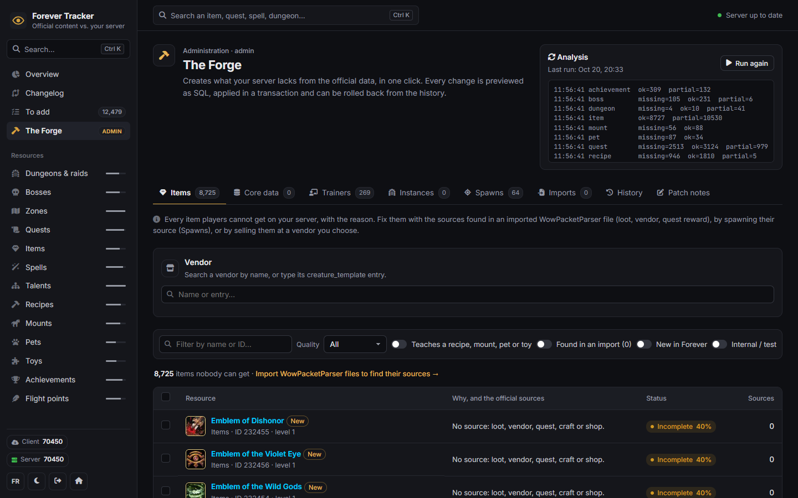
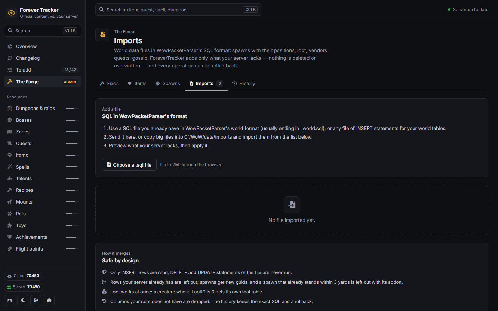
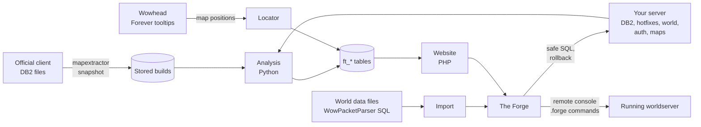

# ForeverTracker

Developed by **[FilinoDZ](https://github.com/filinodz)**.

**See what your WoW Forever server is missing — and fix it.**

ForeverTracker compares the official World of Warcraft Forever client with your TrinityCore-based server. It lists
every resource Blizzard ships — dungeons, bosses, zones, quests, items, spells, talents, recipes, mounts, pets, toys,
achievements, flight points — checks whether players can really get or do each one on your server, explains why
when they cannot, and fixes it: missing core data, trainers, vendors, instances, creatures that were never spawned,
and loot, vendors and quests from world data files you import.

[Français](README.fr.md) · [Installation](docs/INSTALL.md) · [The Forge](docs/FORGE.md) · [Spawns and imports](docs/SPAWNS.md) · [Configuration](docs/CONFIGURATION.md) · [Architecture](docs/ARCHITECTURE.md) · [Changelog](CHANGELOG.md)

## Install in three steps (Windows)

1. **Download** `ForeverTracker-<version>.zip` from the [latest release](https://github.com/filinodz/ForeverTracker/releases/latest)
   and unzip it anywhere (for example next to your server).
2. **Double-click `ForeverTracker.exe`.** The launcher finds PHP and Python, starts the website and opens the setup
   wizard in your browser.
3. **Follow the wizard.** It finds your server and your game client by itself, tests the databases, asks for an
   administrator password, then runs the first analysis (a few minutes). Done: the tracker opens.

|  |  |
|---|---|

**What you need**

| | |
|---|---|
| Your server | A TrinityCore-based WoW Forever server (a repack works): its MySQL databases `auth`, `world`, `hotfixes`, and its data folder (`dbc`, `maps`, `vmaps`) |
| The game | The official WoW Forever client installed on the same computer (to read the official data) |
| PHP 8 with `mysqli` | Many repacks already bring one: the launcher finds it. Otherwise [windows.php.net](https://windows.php.net/download/) (zip, VS16 x64 Thread Safe) unzipped in `C:\php` |
| Python 3.9+ | [python.org](https://www.python.org/downloads/) — tick *Add python.exe to PATH* |

Windows may say *"Windows protected your PC"* the first time, because the launcher is not signed: *More info* ›
*Run anyway*. Its source is in [`tools/launcher`](tools/launcher). Linux, Apache / nginx or a manual setup: see
[the installation guide](docs/INSTALL.md).

## Features

### Coverage of the official content

Thirteen resource types, each with a status (*available*, *incomplete*, *missing*), a score and the list of checks it
passes or fails, in English and French, with a work list by priority, CSV export and a global search (`Ctrl K`).

| Resource | Checks |
|---|---|
| Item | known to the core; obtainable from loot of a spawned creature or object, a spawned vendor, a doable quest, a learnable craft, a container or the shop |
| Quest | `quest_template` row; spawned giver and ender; objectives achievable; not disabled |
| Dungeon / raid | terrain extracted; `instance_template`; entrance teleporter; creatures spawned; every boss spawned; navigation mesh |
| Boss | a creature of that name spawned in the instance; scripted (ScriptName or SmartAI) |
| Zone | creatures spawned in its area; most of its quests doable; graveyard |
| Spell, talent, recipe | known to the core; learnable (trainer, quest reward, automatic, item); script advice for dummy effects |
| Mount, pet, toy | the item or spell that teaches it can be obtained |
| Achievement | known to the core; `achievement_reward` when it has a reward |
| Flight point | a flight master spawned next to the node |

|  |  |
|---|---|

### Changelog of every client build

Each stored build of the client is compared with the previous one, field by field: what Blizzard added, changed or
removed. Administrators can attach Blizzard's patch notes to a build.

### In-game tooltips

Hover any resource for its tooltip, computed with the core's own formulas: item level, armor, weapon damage and DPS,
stats, *Use / Equip / Chance on hit* effects, item sets, sell price; spell cost, range, cast time, cooldown, reagents
and description with its values filled in.

|  |  |
|---|---|

### The Forge

The administration area. Every change is previewed as SQL, applied in one transaction per database, recorded in the
history with its rollback, and safe to repeat: rows your server already has are never inserted twice.

| Part | What it does |
|---|---|
| **Items** | Every item players cannot get, with the reason and the sources found in imported files; applies those sources, or sells the item at a vendor you choose |
| **Core data** | Copies the official records the core does not know (items, spells, mounts, pets, toys, achievements, talents and everything they depend on) into the `hotfixes` database |
| **Trainers** | Teaches class and profession spells nobody teaches, at the spawned trainers of the same skill line, with a level and a price taken from their neighbours |
| **Instances** | Creates the `instance_template` row of dungeons and raids |
| **Spawns** | Places the creatures and objects the content needs but nobody spawned, at their official positions |
| **Imports** | Merges world data files in WowPacketParser's SQL format: spawns, loot, vendors, quests, gossip |

|  |  |
|---|---|

### Spawns: the creatures nobody placed

Many quests fail only because a creature was never spawned: the template exists, the quest points to it, but nobody
stands in the world. The **locator** finds the quest givers, enders, objectives, vendors, trainers, rare drops and
bosses your server knows but never spawned, and where they stand on Wowhead's public maps. The Forge places them on the
running server (exact height computed by the server), in the database, in game with the **ForeverForge** addon, or
gives the GM commands.

|  |  |
|---|---|

### Imports: loot, vendors and quests

Drops, vendor lists and quest rewards are server data: they are never in the game client. ForeverTracker imports
world data files in [WowPacketParser](https://github.com/TrinityCore/WowPacketParser)'s SQL format and adds only what
your server lacks.

Light theme, French interface and phone layout:

| | | |
|---|---|---|
|  |  |  |

## How it works

**1. The official content.** The client's DB2 files of each build (extracted with your core's `mapextractor`) are
stored in `data/builds/<build>/`. A WDC5 reader decodes them with the layouts of your core (`DB2LoadInfo`), including
compressed, sparse and relationship columns. Comparing a build with the previous one gives the changelog.

**2. The analysis.** It reads those tables next to your server: its own DB2 files, the `hotfixes`, `world` and `auth`
databases, and its maps, vmaps and mmaps. For every resource it runs the checks above — for an item, whether any
spawned creature or object drops it (following reference loot), a spawned vendor sells it, a doable quest rewards it,
a learnable recipe crafts it… — iterating until nothing new becomes obtainable, because quest chains unlock items
that unlock other quests. Results go to ForeverTracker's own `ft_*` tables; the game databases are only read.

**3. The Forge.** A fix is not stored as SQL but as operations: a table, its columns, the rows to add and the columns
that identify a row. Applying a selection merges the operations, keeps each row once, asks the server which rows
already exist at that moment and leaves them out, writes the rest in one transaction per database, and saves a
rollback that deletes exactly what was inserted. `tools/forge-check.php` dry-runs every fix.

**4. Positions (locator).** For each unspawned creature or object the content needs, the locator asks Wowhead's
public Forever tooltip service (politely, one request at a time, cached) where it stands: a zone and points in
percent of that zone's map. The client's own map tables (`UiMap`, `UiMapAssignment`, `UiMapGroupMember`) give the
world rectangle drawn on each map, so the percentages convert back to world coordinates — a few yards from the
official positions outdoors. Points are merged into spawns (packs for quest objectives, one creature per place
otherwise), and the nearest existing spawn gives a height hint and a facing. Inside dungeons Wowhead has no
positions: the ForeverForge addon lets a GM place them by hand.

**5. Spawning.** The optional core module ([`core/forge_commands.cpp`](core/README.md)) adds `.forge spawn` to the
worldserver: the server computes the ground height from its maps and vmaps (buildings included), saves the spawn like
`.npc add` and shows it at once. The website sends these commands through the remote console (RA); the
**ForeverForge** addon sends them in game through TrinityCore's addon command channel, or travels to each point with
`.go xyz` on a core without the module.

**6. Imports.** Loot, vendor lists and quest rewards never reach the game client, so they cannot be read from it.
TrinityCore's world data is shared as SQL in WowPacketParser's format; ForeverTracker reads such files and merges
them: only `INSERT` rows are read (the file's `DELETE` and `UPDATE` are never run), rows your server already has are
left out, spawns get new guids and are never doubled (an existing spawn within 3 yards wins), a creature gets its
loot table linked when it had none, and columns or tables your core does not have are dropped.

## Documentation

| | |
|---|---|
| [Installation](docs/INSTALL.md) | Launcher and wizard, manual setup, Linux, Apache and nginx, updates |
| [The Forge](docs/FORGE.md) | Every fix, how it is applied and rolled back |
| [Spawns and imports](docs/SPAWNS.md) | The locator, the four ways to spawn, the core module, the addon, importing WowPacketParser SQL files |
| [Configuration](docs/CONFIGURATION.md) | Every setting of `config.ini` |
| [Architecture](docs/ARCHITECTURE.md) | The code: analysis, tables, website, Forge engine |

## Safety

- The analysis only reads the game databases.
- The Forge writes only when an administrator confirms, in one transaction per database, and keeps the exact SQL and
  its rollback in the history. Back up your databases anyway.
- The setup wizard answers only the computer that runs ForeverTracker until it is configured, then only
  administrators.

## License

MIT — see [LICENSE](LICENSE). ForeverTracker is an unofficial tool, not affiliated with Blizzard Entertainment.
World of Warcraft content and icons © Blizzard Entertainment; icons are loaded from Wowhead's public image CDN.
